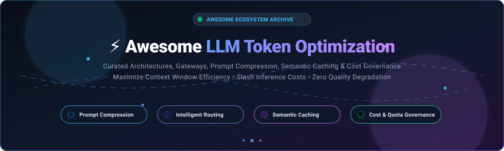

# Awesome-LLM-Token-Optimization

  

  
  
  
  
  
  

---

## 🚀 Top LLM Token Optimization Ecosystem

**Curated Directory of Enterprise SaaS Gateways & High-Performance Open-Source Projects**  
*Comprehensive architectures for Prompt Compression, Semantic Caching, Intelligent Routing, KV-Cache Optimization & Self-Hosted Cost Governance.*

📅 **Last updated:** October 2026

**Awesome LLM Token Optimization** is a comprehensive, production-grade index of software tools, frameworks, and hosted platforms designed to maximize context efficiency and reduce large language model (LLM) API costs and latency. By compressing input context, reusing prompt prefixes, caching semantic completions, deduplicating repetitive chat histories, and dynamically routing prompts to cost-effective models, these tools unlock drastic inference savings without compromising response quality.

**Key highlights**:
- 🗜️ **Context & Prompt Compression**: Shrink tool outputs, JSON structures, retrieval payloads, and chat logs by up to 80%.
- 🔀 **Intelligent Model Routing**: Dynamically match prompt complexity to the cheapest capable model (e.g., routing between Claude 3.5 Sonnet, GPT-4o, and Llama 3.3).
- ⚡ **Semantic Caching & Prefix Caching**: Serve identical or semantically equivalent queries from cache without re-querying frontier models.
- 🛡️ **Self-Hosted Cost Governance**: Enforce team budgets, rate limits, BYOK credentials, and full data sovereignty.

---

## 📑 Table of Contents

- [📊 Sector Overview & Market Dynamics](#-sector-overview--market-dynamics)
- [☁️ SaaS/Hosted Platforms](#️-saashosted-platforms)
- [🔓 Open-Source GitHub Projects](#-open-source-github-projects)
  - [Top Tier Frameworks & Gateways](#top-tier-frameworks--gateways)
  - [Specialized Compression & Caching Proxies](#specialized-compression--caching-proxies)
- [🛠️ How to Contribute](#️-how-to-contribute)
- [⭐ Star History](#-star-history)
- [💖 Support & Sponsorship](#-support--sponsorship)
- [⚠️ Disclaimer](#️-disclaimer)

---

## 📊 Sector Overview & Market Dynamics

The LLM Gateway and AI Observability / Token Optimization sector is estimated at **$820M to $1.7B+** globally, expanding rapidly at an estimated CAGR of ~25%–30% toward $7B+ by the early 2030s. The market is **moderately fragmented** at the developer and startup tier—with a proliferation of open-source proxies, model routers, and prompt optimizers—while actively **concentrating at the infrastructure tier** as cloud hyperscalers, APM suites, and established security/infrastructure leaders acquire category-defining platforms.

---

## ☁️ SaaS/Hosted Platforms

| Platform | Company Size (Valuation / Revenue) | Starting Paid Tier Pricing | Free Tier Limits | Key Capabilities & Highlights |
| :--- | :--- | :--- | :--- | :--- |
| **[Cloudflare AI Gateway](https://developers.cloudflare.com/ai-gateway/)** | ~$75B–$85B Market Cap ($2.17B FY25 Revenue) | **$5/month** (Workers Paid plan) | **100,000 logs total limit** across up to 10 gateways; unlimited requests with BYOK credentials; core analytics & caching free | Edge-level exact-match response caching (SHA-256 hash), rate limiting, DLP scanning, and multi-provider analytics. |
| **[Portkey](https://portkey.ai/)** | ~$140M Valuation (Acquired by Palo Alto Networks; $18M+ raised) | **$49/month** (Production Starter tier) | **10,000 recorded logs/month** (requests continue unblocked after limit); free forever | AI gateway featuring Headroom context compression, BYO-proxy deployment for local data residency, multi-provider load balancing, and guardrails. |
| **[Langfuse (Cloud)](https://langfuse.com/)** | Seed-funded ($4M raised, backed by Lightspeed & YC; acquired by ClickHouse) | **$29/month** (Core plan) | **50,000 units/month** (traces/observations), 30 days retention, 2 user seats, 1,000 requests/min ingestion rate limit | Hosted tier of open-source LLM engineering platform; distributed tracing, token/cost attribution, prompt management, and prompt playground. |
| **[Helicone](https://www.helicone.ai/)** | ~$25M Valuation ($5M Seed, YC W23; ~$1M ARR) | **$79/month** (Pro plan) | **10,000 requests/month**, 1 GB storage, 7-day data retention, 1 seat; free forever | AI Gateway and observability platform featuring cost-based routing across BYOK credentials, session-level cost tracking, and response caching. |
| **[Martian](https://withmartian.com/)** | Venture-backed (~$9M–$23M raised, NEA & Prosus Ventures) | Pay-as-you-go per-token provider rates + routing compute fees (Enterprise custom) | **Free developer trial / tier** for prototyping router API requests without upfront platform commitments | Dynamic model router predicting and directing prompt workloads to the most cost-effective LLM based on prompt complexity and performance targets. |
| **[PromptLayer](https://www.promptlayer.com/)** | Seed-funded ($4.8M raised, Stellation Capital & ScOp VC) | **$49/month** (Pro plan) | **2,500 requests/month**, 10 prompts, 250 eval cell executions/month, 10 MB dataset limit, up to 5 users | Prompt registry, versioning, production request tracing, side-by-side prompt comparisons, and automated evaluations. |
| **[Maxim AI](https://www.getmaxim.ai/)** | Seed-funded ($3M raised, Elevation Capital) | **$29/seat/month** (Professional plan) | **10,000 logs/month**, 3 seats, 1 workspace, 3-day data retention; free forever | Enterprise LLM evaluation, distributed tracing, cost-per-trace analytics, simulation playground, and Bifrost open-source gateway. |

---

## 🔓 Open-Source GitHub Projects

*Ranked and sorted in descending order of GitHub community stars. Each project includes a live Stars_Count badge linking directly to its stargazer community.*

### Top Tier Frameworks & Gateways

1. **[Caveman](https://github.com/JuliusBrussee/caveman)**   
   **The context compression proxy for coding agents.** Caveman v1 pioneered terser agent communication styles to reduce output tokens. **Caveman 2** adds input compression: a local proxy that shrinks tool outputs, logs, JSON blobs, and search results before they reach the model.  
   - **Compression targets**: JSON 70–90%, logs 85–95%, code 40–70%, diffs 60–80%, search results 80–95%.  
   - **Benchmark reality check**: JetBrains ran a paired A/B benchmark on real agentic tasks and identified ~8.5% output token savings without measurable quality degradation (82 paired tasks, p=0.82).  
   - **Licensing**: Skill is MIT; proxy engine is BSL-1.1 (free self-hosted use).

2. **[vLLM](https://github.com/vllm-project/vllm)**   
   **High-throughput and memory-efficient LLM serving engine.** Invented **PagedAttention**, which manages KV cache memory with near-zero waste (reducing KV cache memory footprint from 60–80% waste down to under 4%). Supports automatic prefix caching (APC), speculative decoding, chunked prefill, and continuous batching—dramatically reducing the token compute overhead and memory consumption of serving self-hosted LLMs.

3. **[LiteLLM](https://github.com/BerriAI/litellm)**   
   **The universal LLM proxy with routing and budget controls.** Provides a unified OpenAI-compatible interface across 100+ providers, with **cost-based routing**, fallbacks, load balancing, and per-key/per-team budget enforcement. Includes a deduplication hook (`litellm_settings.callbacks`) benchmarked to cut prompt tokens by **32.3%** and cost by **30%**, billing-verified.

4. **[SGLang](https://github.com/sgl-project/sglang)**   
   **Fast serving framework for complex LLM programs and multi-turn workflows.** Introduces **RadixAttention**, which automatically retains and reuses the KV cache across multiple requests with shared prompt prefixes (such as few-shot exemplars, system prompts, multi-turn chat sessions, and tree searches). Yields up to 5x higher throughput and massive token latency reductions.

5. **[Langfuse (Self-Hosted)](https://github.com/langfuse/langfuse)**   
   **The open-source LLM engineering and observability platform.** Full self-hosted telemetry providing distributed tracing, prompt management, evaluation, and the Langfuse Playground. Enables engineering teams to empirically measure token counts, benchmark prompt variations, and minimize input tokens while maintaining output precision.

6. **[GPTCache](https://github.com/zilliztech/GPTCache)**   
   **Semantic cache for LLM queries to cut latency and API token burn.** Instead of requiring exact string matches, GPTCache uses vector embeddings and similarity search to identify semantically equivalent prompts, returning cached LLM responses in milliseconds. Fully integrates with LangChain, LlamaIndex, and OpenAI APIs.

7. **[LLMLingua](https://github.com/microsoft/LLMLingua)**   
   **Prompt compression framework developed by Microsoft Research.** Uses a compact language model (e.g., Llama-2-7B or GPT2-small) to identify and remove redundant, non-essential tokens from extensive prompts, RAG context, and instruction documents. Achieves up to **20x prompt compression** with minimal reasoning or performance degradation.

8. **[Helicone (Self-Hosted)](https://github.com/Helicone/helicone)**   
   **Open-source LLM observability and cost analytics.** Self-hosting gives developers complete data retention control, automated request caching, cost-based multi-provider routing, and granular user/session token consumption tracking without exposing payloads to third-party endpoints.

### Specialized Compression & Caching Proxies

- **[Paritok](https://github.com)** — Lightweight context compression proxy with OpenAI and Anthropic compatible routing. Exposes live compression ratios via `/stats` and computes real-time cache savings.
- **[Unify](https://github.com)** — Unified Python SDK and routing layer benchmarking LLM quality, latency, and cost per million tokens across model endpoints in real time.

---

## 🛠️ How to Contribute

Contributions are welcome! Help build the definitive index for LLM token optimization:

1. 🍴 Fork the repository.
2. 📝 Add or edit entries in `README.md` (keep descriptions objective, factual, and benchmark-verified).
3. 🔗 Verify all links, GitHub handles, and pricing tiers.
4. 🚀 Submit a Pull Request with a clear description of the project.

---

## ⭐ Star History

---

## 💖 Support & Sponsorship

Thank you for visiting and supporting **Awesome LLM Token Optimization**! 🙌

If you find this repository valuable for your AI engineering workflows, cost reductions, or research, please consider:
- ⭐ **Starring** the repository to boost visibility.
- 🍴 **Forking** and contributing new optimization tools, proxies, and benchmarks.
- 📢 **Sharing** with your network, engineering teammates, and AI communities.
- ☕ **Buying a coffee / Sponsoring the project**: Support ongoing maintenance, community benchmarks, and curated open-source research via the [GitHub Sponsor Dashboard](https://github.com/sponsors/ishandutta2007).

---

## ⚠️ Disclaimer

- 📌 This repository is a **community-curated index** — entries do not imply formal endorsement.
- ⚖️ **Token savings claims require empirical scrutiny**: Advertised compression percentages often reflect synthetic prose tests. In agentic or coding workflows dominated by syntax and tool calls, realistic savings generally range between 8% and 35%. Always validate with `audit` mode or paired A/B benchmarks.
- 🔒 **Verify licensing**: Open-source licenses vary from permissive (MIT/Apache-2.0 in vLLM, LiteLLM, Langfuse, LLMLingua, GPTCache) to source-available (BSL-1.1 in Caveman). Check commercial deployment compatibility.
- 🔍 **Observability vs. Optimization**: Observability platforms trace token spend; pair them with caching, compression proxies, or intelligent routing to realize direct billing reductions.

---

  <b>Built for AI engineers, platform architects, and developers engineering efficient LLM systems.</b>

